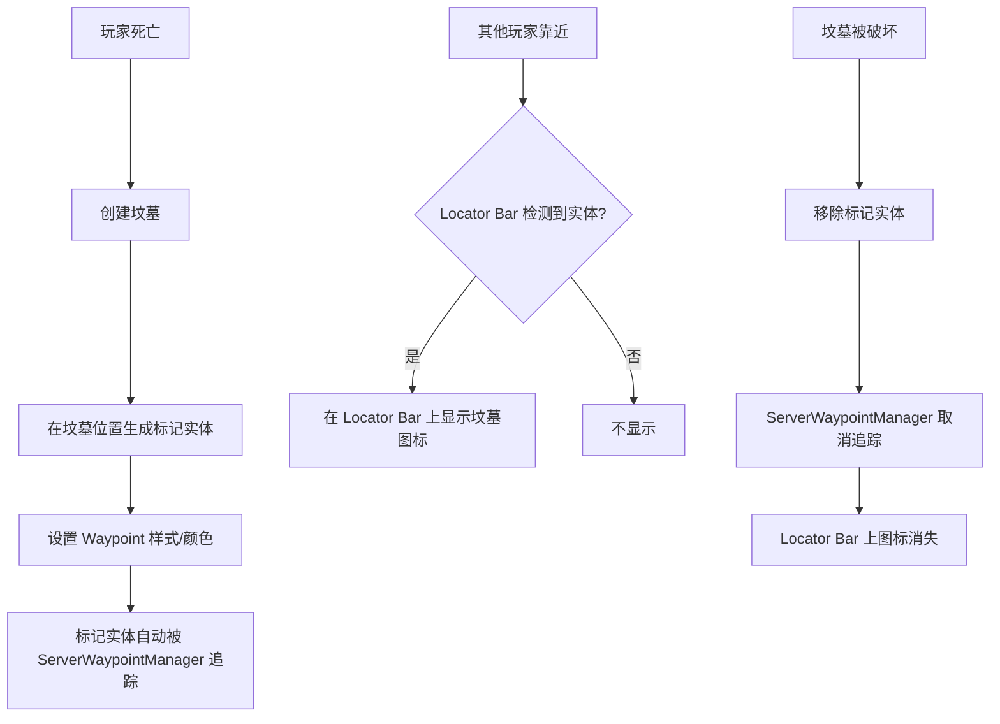

# 坟墓定位器（Grave Locator Bar）设计计划

## 概述

利用 Paper 1.21.6+ 新增的 **Waypoint Styling API**（PR [#12964](https://github.com/PaperMC/Paper/pull/12964)），在 Minecraft 原版 **Player Locator Bar**（玩家定位条）上为坟墓添加自定义路径点标记，让玩家能直观地在 HUD 上看到坟墓的位置和方向。

## 技术原理

### Waypoint Styling API

Paper 在 [`LivingEntity`](src/main/java/org/bukkit/entity/LivingEntity.java) 接口新增了以下方法：

| 方法 | 说明 |
|------|------|
| `setWaypointStyle(@Nullable Key key)` | 设置路径点图标样式（如 `minecraft:default`、`minecraft:bowtie`）|
| `setWaypointColor(@Nullable Color color)` | 设置路径点图标颜色 |
| `getWaypointStyle()` | 获取当前图标样式 |
| `getWaypointColor()` | 获取当前图标颜色 |

### 核心思路

当玩家死亡生成坟墓时，在坟墓位置**生成一个不可见的标记实体**（如 Marker Armor Stand），并设置其路径点样式和颜色（如红色 `bowtie` 图标）。当玩家靠近时，这个实体将自动出现在玩家的 **Locator Bar** 上，显示其相对位置。

### 与 `sendExperienceChange` 方案对比

| 方案 | 优点 | 缺点 |
|------|------|------|
| ✅ **Waypoint API 方案** | 使用原版 Locator Bar，直观显示方向；不影响玩家经验值；视觉效果好 | 需要额外实体；依赖 Paper 1.21.6+ API |
| ❌ `sendExperienceChange` 方案 | 无需额外实体 | 模拟方向不精确；影响经验条显示；体验不如原版 |

## 系统设计

### 流程图



### 标记实体设计

在坟墓位置生成一个 [`Marker`](https://jd.papermc.io/paper/1.21.4/org/bukkit/entity/Marker.html) 类型实体（1.20.5+ 新增的不可见无碰撞实体）。

```yaml
实体类型: Marker 或 Interaction
位置: 坟墓方块中心
是否可见: 否（无模型、无碰撞箱）
自定义名称: "坟墓 #1"（可选，仅在调试时可见）
```

### Waypoint 样式设置

```java
// 创建标记实体
World world = graveLocation.getWorld();
Marker marker = world.spawn(graveLocation, Marker.class);

// 设置路径点图标样式为 bowtie（更显眼）
marker.setWaypointStyle(Key.key("minecraft:bowtie"));

// 设置路径点图标颜色为金色/红色
marker.setWaypointColor(Color.fromRGB(0xFFAA00)); // 金色
```

### 生命周期管理

| 事件 | 操作 |
|------|------|
| 玩家死亡 → 坟墓创建 | 生成标记实体，设置 Waypoint 样式 |
| 玩家在附近 | Locator Bar 自动显示图标和相对位置 |
| 坟墓被破坏 | 移除标记实体 |
| 服务器重启 | 启动时遍历数据库中的坟墓，重新生成标记实体 |
| 玩家切换世界 | Locator Bar 自动适配（不同世界的实体不显示） |

### 多坟墓场景

如果玩家有多个坟墓，Locator Bar 会显示所有标记实体，玩家可以直观地看到每个坟墓的方向。

## 实现文件

### 新增文件

#### `src/main/java/com/pixelcatt/simplegraves/GraveWaypointManager.java`

主要职责：
- 管理标记实体的创建和销毁
- 维护 `Map<Location, Entity> graveWaypoints` 映射
- 提供 `createWaypoint(Location)` 和 `removeWaypoint(Location)` 方法

```java
public class GraveWaypointManager {
    
    private final SimpleGraves plugin;
    private final GraveManager manager;
    private final Map<Location, Entity> waypoints = new HashMap<>();
    
    // 坟墓位置 → 标记实体
    private static final Key WAYPOINT_STYLE = Key.key("minecraft:bowtie");
    private static final Color WAYPOINT_COLOR = Color.fromRGB(0xFFAA00);
    
    public void createWaypoint(Location graveLoc) {
        Marker marker = graveLoc.getWorld().spawn(graveLoc, Marker.class);
        marker.setWaypointStyle(WAYPOINT_STYLE);
        marker.setWaypointColor(WAYPOINT_COLOR);
        marker.setPersistent(true);
        waypoints.put(graveLoc, marker);
    }
    
    public void removeWaypoint(Location graveLoc) {
        Entity entity = waypoints.remove(graveLoc);
        if (entity != null) entity.remove();
    }
    
    public void loadAllWaypoints() {
        // 从数据库加载所有坟墓位置，重新生成标记实体
        manager.getEveryGraveLocation().thenAccept(locations -> {
            for (Location loc : locations) {
                if (!waypoints.containsKey(loc)) {
                    createWaypoint(loc);
                }
            }
        });
    }
    
    public void removeAllWaypoints() {
        waypoints.values().forEach(Entity::remove);
        waypoints.clear();
    }
}
```

### 修改现有文件

#### `SimpleGraves.java`

- 新增 `GraveWaypointManager waypointManager` 字段
- 在 `onEnable()` 中初始化并加载所有路径点
- 在 `onDisable()` 中清理所有标记实体

#### `GraveManager.java`

- 在 `insertGraveAndPlaceBlock()` 中创建坟墓后调用 `waypointManager.createWaypoint()`
- 在 `breakGrave()` 中破坏坟墓前调用 `waypointManager.removeWaypoint()`

#### `config.yml`（可选）

```yaml
# Grave Waypoint / Locator Bar settings
grave-waypoint:
  # 是否启用 Locator Bar 路径点标记 (Default: true)
  enabled: true
  
  # 路径点图标样式 (Default: "minecraft:bowtie")
  # 可选: "minecraft:default", "minecraft:bowtie"
  style: "minecraft:bowtie"
  
  # 路径点图标颜色 (Default: "#FFAA00" 金色)
  # 格式: HEX 颜色代码
  color: "#FFAA00"
```

## 注意事项

1. **Paper 版本要求**：需要 Paper 1.21.6+（包含 Waypoint Styling API）
2. **Folia 兼容性**：实体生成和移除需要通过 `FoliaHelper.runAtLocation()` 在正确的区域线程执行
3. **性能**：标记实体非常轻量（Marker 无 AI、无碰撞箱、无渲染），每个坟墓一个标记实体对性能影响极小
4. **持久化**：标记实体不会自动保存到世界文件，服务器重启后需要通过 `loadAllWaypoints()` 重新生成
5. **隐藏自己的坟墓图标**：如果不想让玩家看到自己的坟墓标记，可以通过 `player.hideEntity()` 隐藏

## 实施步骤

1. **查阅 Paper Waypoint API 文档**，确认 Marker 实体是否支持 Waypoint
2. **新建 `GraveWaypointManager.java`**
3. **修改 `SimpleGraves.java`** 集成 Waypoint Manager
4. **修改 `GraveManager.java`** 在创建/破坏坟墓时更新路径点
5. **修改 `config.yml`** 添加配置项
6. **测试验证**：确认 Locator Bar 上显示坟墓图标
